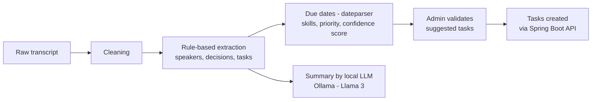
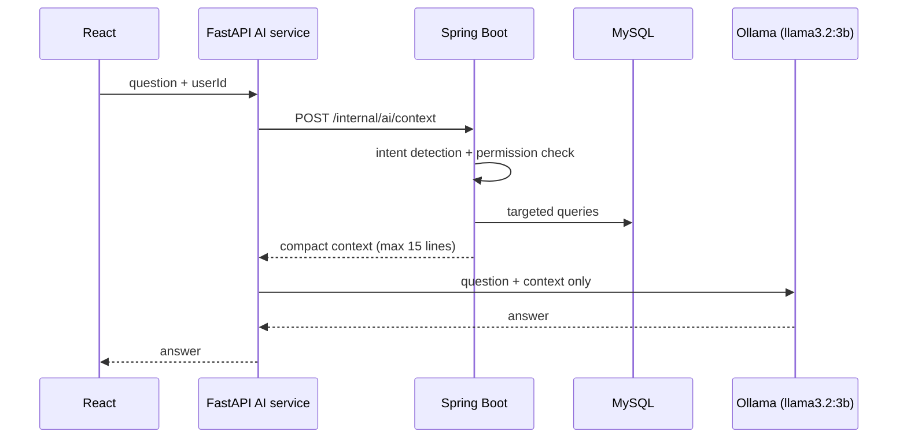
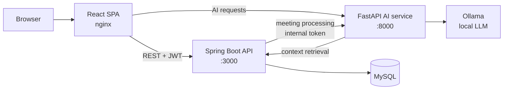

# IT-CHU Manager — IT Project Management Platform with an AI Assistant


IT-CHU Manager is a project management platform built for the **IT department of a university hospital (CHU)**. It covers the full project workflow (projects, tasks, Kanban board, meetings, workload, notifications and audit trail) and adds two AI features that run on a **local LLM (Ollama)**:

- **Meeting transcript processing:** extracts decisions and action items from a raw meeting transcript, suggests tasks for human validation and writes a meeting summary.
- **Data-grounded assistant:** answers questions about projects, tasks and meetings using only data retrieved from the application database, filtered by the user's permissions.

The system follows a **three-tier, service-oriented architecture**: a React single-page application, a Spring Boot REST API, and a separate Python FastAPI service for AI processing.

---

## Table of Contents

- [Objectives](#objectives)
- [Key Features](#key-features)
- [AI Features](#ai-features)
- [Tech Stack](#tech-stack)
- [Architecture](#architecture)
- [Project Structure](#project-structure)
- [Getting Started](#getting-started)
- [API Overview](#api-overview)
- [Database](#database)
- [Testing](#testing)
- [Screenshots](#screenshots)
- [Limitations & Future Work](#limitations--future-work)
- [Author](#author)

---

## Objectives

- Centralize the management of IT projects, tasks and meetings for a hospital IT team.
- Give managers real-time visibility on progress, delays and team workload.
- Reduce the manual work of writing meeting minutes and creating follow-up tasks.
- Let team members query project data in natural language, **without the LLM inventing facts**.
- Apply production-oriented practices: layered architecture, JWT security, database migrations, containerization and automated tests.

## Key Features

**Two roles**
- `ADMIN` — full administration: users, projects, meetings, AI processing, audit log.
- `MEMBRE` (member) — personal dashboard, assigned projects and tasks, meetings, workload, notifications and assistant.

**Modules**
- **Dashboard** — KPIs, charts, workload overview, urgent tasks and recent activity.
- **User management** — create, update, activate / deactivate users, manage roles and skills.
- **Project management** — CRUD, team members, status (active, paused, completed), priority and progress tracking.
- **Task management** — CRUD, assignment, priorities, due dates and full **change history**.
- **Kanban board** — drag-and-drop between *To do*, *In progress*, *In review* and *Done*.
- **Meetings** — scheduling, participants, agenda, manual notes, transcript, decisions and actions.
- **Workload** — planned hours per member against a 35-hour weekly capacity.
- **Notifications** — delays, overload, untreated decisions, meetings and tasks (read / unread).
- **Timeline & tracking charts** for project follow-up.
- **Audit log** of user actions.

## AI Features

### 1. Meeting transcript processing



- Extraction is **deterministic**: keyword rules detect decisions and action items; `dateparser` extracts due dates; IT skills (Java, Docker, network, security, ...) and urgency keywords are detected; each task gets a confidence score.
- The LLM is used **only to write the summary** from the extracted elements, with a prompt that forbids adding information. If Ollama is unavailable, a deterministic summary is returned.
- **Human-in-the-loop:** suggested tasks are reviewed by an admin before being created.
- The backend can also trigger processing for a stored meeting (`POST /api/meetings/{id}/process`). It then calls the AI service's internal endpoint, protected by a shared bearer token, and stores the summary, decisions and actions.

### 2. Data-grounded assistant



- Spring Boot detects the **intent** of the question among 12 supported intents: active projects, late projects, project progress, project members, critical tasks, overdue tasks, unassigned tasks, task count, task assignee, latest meeting, meeting decisions and orphan actions.
- Permissions are **recomputed server-side** from the user: members only see data from their own scope.
- The LLM receives only the retrieved context and strict instructions (no external knowledge, no recalculated values, temperature 0.3). Greetings are answered without calling the database or the LLM.
- If Ollama is down, the assistant returns the retrieved data as is.

> This is retrieval-augmented generation based on **intent detection and SQL queries**, not on embeddings or a vector database.

## Tech Stack

| Layer | Technologies |
|---|---|
| Frontend | React 19, Vite, Tailwind CSS, Recharts, Axios, native HTML5 drag and drop, oxlint |
| Backend | Java 21, Spring Boot 3.4, Spring Web, Spring Security, JWT (jjwt, access + refresh tokens), Spring Data JPA, Bean Validation, Flyway, springdoc-openapi (Swagger UI), Spring Boot Actuator, Maven |
| AI service | Python, FastAPI, Pydantic v2, dateparser, requests, Ollama (Llama 3 / Llama 3.2 3B) |
| Database | MySQL 8.4 (H2 for tests) |
| DevOps | Docker, Docker Compose, nginx |
| Testing | JUnit 5, Spring Boot Test, Spring Security Test |

## Architecture



**Backend design (layered architecture)**

| Package | Responsibility |
|---|---|
| `controller` | REST endpoints |
| `service` | Business logic (projects, tasks, Kanban, workload, dashboard, AI context) |
| `service/ai` | `MeetingAiPipeline` interface with an HTTP implementation and a no-op fallback, enabled by configuration (`app.ai.enabled`) |
| `repository` | Spring Data JPA repositories |
| `domain` | JPA entities and enums |
| `dto` / `mapper` | Request / response objects and mapping |
| `security` | JWT filter, token service, Spring Security configuration |
| `exception` | Custom exceptions and global error handler |
| `config` | CORS, OpenAPI, password encoder, demo data seeder |

## Project Structure

```
gestion-projet-CHU/
├── backend/                  # Spring Boot REST API
│   ├── src/main/java/com/itchu/
│   │   ├── controller/  service/  repository/  domain/
│   │   ├── dto/  mapper/  security/  exception/  config/
│   ├── src/main/resources/
│   │   ├── application*.yml
│   │   └── db/migration/     # Flyway migrations
│   ├── src/test/             # JUnit tests
│   └── Dockerfile
├── fastapi-ai-service/       # Python AI service
│   └── app/
│       ├── routers/          # meetings, chat, internal
│       ├── services/         # cleaning, extractor, llm_service, rag_engine, spring_client
│       └── models/           # Pydantic schemas
├── frontend/                 # React SPA
│   └── src/
│       ├── api/              # REST clients per resource
│       ├── components/       # Admin views (+ user/ for member views)
│       ├── layouts/          # Admin and member layouts
│       ├── context/          # Authentication context
│       └── lib/              # HTTP client, AI client, helpers
├── sql/                      # Reference schema and sample data
├── docker-compose.yml
└── .env.example
```

## Getting Started

### Option 1 — Docker Compose (application) + local AI service

Prerequisites: Docker and Docker Compose. For AI features: Python 3.11+ and [Ollama](https://ollama.com/).

```bash
git clone https://github.com/hind-bass/gestion-projet-CHU.git
cd gestion-projet-CHU
cp .env.example .env
docker compose up --build
```

| Service | URL |
|---|---|
| Frontend | http://localhost:5173 |
| Backend API | http://localhost:3000 |
| Swagger UI | http://localhost:3000/swagger-ui.html |
| Health check | http://localhost:3000/actuator/health |
| MySQL (from the host) | localhost:3307 |

The Docker profile seeds demo data (users, projects, tasks, meetings and notifications):

| Role | Email | Password |
|---|---|---|
| Admin | `admin@chu.local` | `Admin123!` |
| Member | `youssef.alaoui@chu.local` | `Member123!` |

**Start the AI service** (runs on the host; the backend container reaches it through `host.docker.internal:8000`):

```bash
ollama pull llama3
ollama pull llama3.2:3b

cd fastapi-ai-service
python -m venv .venv
source .venv/bin/activate        # Windows: .venv\Scripts\activate
pip install -r requirements.txt
uvicorn app.main:app --port 8000 # docs: http://localhost:8000/docs
```

### Option 2 — Local development

**Backend** — Java 21, Maven 3.9+, MySQL 8 (connection settings in `application-dev.yml`):

```bash
cd backend
mvn spring-boot:run -Dspring-boot.run.profiles=dev
```

**Frontend** — Node.js 20+:

```bash
cd frontend
npm install
npm run dev    # Vite dev server on http://localhost:5175, proxies /api to :3000
```

### Main environment variables

| Variable | Purpose |
|---|---|
| `JWT_ACCESS_SECRET`, `JWT_REFRESH_SECRET` | JWT signing secrets (change them outside local development) |
| `APP_SEED_ENABLED` | Seed demo data at startup |
| `APP_AI_ENABLED` | Enable the HTTP meeting AI pipeline |
| `IA_SERVICE_URL`, `IA_SERVICE_INTERNAL_TOKEN` | AI service URL and shared internal token |
| `SPRING_API_URL` | (AI service) Spring Boot URL used for context retrieval |
| `OLLAMA_URL`, `OLLAMA_MODEL` | (AI service) Ollama endpoint and summary model |

## API Overview

Interactive documentation: **Swagger UI** at `/swagger-ui.html`.

| Resource | Base path |
|---|---|
| Authentication (`login`, `refresh`, `logout`, `me`) | `/api/auth` |
| Users | `/api/users` |
| Projects | `/api/projects` |
| Kanban | `/api/projects/{projectId}/kanban` |
| Tasks | `/api/tasks` |
| Meetings (+ `POST /{id}/process` for AI processing) | `/api/meetings` |
| Notifications | `/api/notifications` |
| Dashboard | `/api/dashboard` |
| Workload | `/api/workload` |
| Audit log | `/api/audit-logs` |
| AI context (internal, used by the AI service) | `/internal/ai` |

**AI service (FastAPI):** `POST /api/ai/meetings/process`, `POST /api/ai/chat/`, `POST /internal/meetings/process`, `GET /health`.

## Database

The MySQL schema is versioned with **Flyway**:

- `V1__init_schema.sql` — core tables
- `V2__user_actif_and_refresh_tokens.sql` — user activation, persisted refresh tokens, manual meeting notes

Main entities: `User`, `Project`, `ProjectMember`, `Task`, `TaskHistory`, `Meeting`, `MeetingAction`, `MeetingDecision`, `Notification`, `AuditLog`, `WorkloadSnapshot`, `RefreshToken`.

## Testing

The backend includes **13 JUnit tests** running on an in-memory H2 database:

- `AuthControllerTest` — login, invalid password, authentication required on `/me`, current user with token.
- `DomainServicesTest` — duplicate email rejection, token issuance, project lifecycle and membership, task status changes by the assignee, member permission checks, meeting visibility for participants.
- `TaskApiIT` — task listing and Kanban columns through the API.
- `ItChuManagerApplicationTests` — application context loading.

```bash
cd backend
mvn test
```

## Screenshots

<!-- TODO: add screenshots to docs/screenshots/ and reference them here, for example:


-->

## Limitations & Future Work

- **Assistant authentication:** the frontend currently sends the `userId` to the AI service without forwarding the JWT, so the user identity can be spoofed. Next step: propagate and verify the JWT end to end.
- Restrict CORS on the AI service (currently open to all origins).
- Add the AI service and Ollama to Docker Compose for a one-command setup.
- Replace keyword-based extraction with an NLP model (named entity recognition, classification) and measure extraction precision and recall on annotated transcripts.
- Add semantic search (embeddings) for free-form questions not covered by the 12 intents.
- Add frontend tests and a CI pipeline.

## Author

**Hind Bassou** — Computer Engineering student, National School of Applied Sciences of Oujda (ENSAO)
GitHub: [@hind-bass](https://github.com/hind-bass)

*Academic project — not intended for production use with real patient or hospital data.*
